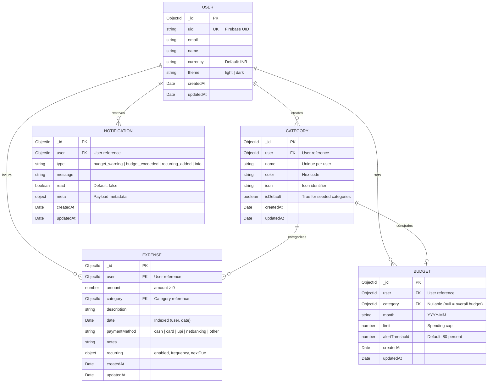

# Smart Expense Tracker - Architecture & Data Model

**Group No. 41** | Department of Information Technology, KIET Group of Institutions (AKTU)

---

## 1. System Architecture Diagram

```
+---------------------------------------------------------------------------------+
|                                 CLIENT TIER                                     |
|                                                                                 |
|   +-----------------------+     +-------------------+     +------------------+  |
|   |  Firebase Web SDK     |     |   React 18 SPA    |     |  Chart.js / CSS  |  |
|   | (Auth Token Issuance) |     |  (Vite + Router)  |     |   (Responsive)   |  |
|   +-----------+-----------+     +---------+---------+     +------------------+  |
+---------------|---------------------------|-------------------------------------+
                | Bearer Token              | Axios API Calls with Auth Header
                v                           v
+---------------------------------------------------------------------------------+
|                                 SERVER TIER                                     |
|                                                                                 |
|  [Security Middlewares]                                                         |
|  - Helmet (HTTP Headers)                                                        |
|  - CORS (CLIENT_ORIGIN Allowlist)                                               |
|  - Express Rate Limit (100 req/15min)                                           |
|  - Express Mongo Sanitize (NoSQL Injection Defense)                             |
|                                                                                 |
|  [Authentication Middleware]                                                    |
|  - Firebase Admin SDK: verifies Bearer ID Token -> attaches req.user            |
|                                                                                 |
|  [Route Layer & Controller Layer]                                               |
|  /api/health       -> healthCheck                                               |
|  /api/auth         -> syncUser, getUser, updateUser                             |
|  /api/categories   -> getCategories, createCategory, updateCategory, ...        |
|  /api/expenses     -> getExpenses, createExpense, updateExpense, exportCSV      |
|  /api/budgets      -> getBudgets, getBudgetStatus, upsertBudget, ...            |
|  /api/analytics    -> getSummary, getByCategory, getMonthly, getBudgetVsActual  |
|  /api/insights     -> getInsights (AI LLM + Rules Engine Fallback)              |
|  /api/notifications-> getNotifications, markAsRead, markAllRead                 |
|                                                                                 |
|  [Background Job Engine]                                                        |
|  - node-cron (00:05 daily): creates recurring expenses, advances nextDue        |
+-------------------------------------------|-------------------------------------+
                                            | Mongoose ODM Queries
                                            v
+---------------------------------------------------------------------------------+
|                              PERSISTENCE & SERVICES                             |
|                                                                                 |
|  +--------------------+     +-----------------------+     +------------------+  |
|  |   MongoDB Atlas    |     |   Firebase Identity   |     | Gemini / OpenAI  |  |
|  |  (Database Engine) |     |   (Identity Provider) |     | (AI Insights API)|  |
|  +--------------------+     +-----------------------+     +------------------+  |
+---------------------------------------------------------------------------------+
```

---

## 2. Directory & Component Structure

```
smart-expense-tracker/
├── .github/
│   └── workflows/
│       └── ci.yml               # GitHub Actions CI workflow (lint & test)
├── client/
│   ├── src/
│   │   ├── api/                 # Axios clients, endpoints, interceptors
│   │   ├── context/             # AuthContext, NotificationContext, ThemeContext
│   │   ├── hooks/               # Custom hooks (useExpenses, useBudgets, etc.)
│   │   ├── components/          # Layout, Navbar, Sidebar, Cards, Modal, Toast
│   │   ├── pages/               # Dashboard, Expenses, Budgets, Analytics, etc.
│   │   ├── utils/               # Currency formatters, date helpers, chart presets
│   │   ├── styles/              # CSS variables, reset, utility classes, themes
│   │   ├── App.jsx              # Routes & ProtectedRoute setup
│   │   └── main.jsx             # Entry point
│   ├── .env.example
│   ├── index.html
│   ├── vite.config.js
│   └── package.json
├── server/
│   ├── src/
│   │   ├── config/              # db.js, firebase.js, env.js
│   │   ├── middleware/          # auth.js, validate.js, errorHandler.js, rateLimiter.js
│   │   ├── models/              # User, Category, Expense, Budget, Notification
│   │   ├── validators/          # Zod validation schemas
│   │   ├── controllers/         # Thin request handling controllers
│   │   ├── services/            # Core business logic, insight rules, AI client
│   │   ├── routes/              # Express route declarations
│   │   ├── jobs/                # Daily recurring expense cron scheduler
│   │   ├── utils/               # AppError, asyncHandler, logger, csvStream
│   │   ├── app.js               # Express application builder
│   │   └── server.js            # Server entrypoint and lifecycle listener
│   ├── tests/                   # Jest + Supertest integration test suite
│   ├── .env.example
│   ├── Dockerfile
│   └── package.json
├── docs/
│   ├── REQUIREMENTS.md
│   ├── ARCHITECTURE.md
│   └── API.md
├── .gitignore
└── README.md
```

---

## 3. Entity-Relationship (ER) Data Model



---

## 4. Key Data Flows

### 4.1 Authentication & Sync
1. Client logs in with Firebase Client SDK (Email/Password or Google Popup).
2. Firebase returns a signed JWT ID Token.
3. Axios interceptor attaches `Authorization: Bearer <ID_TOKEN>`.
4. Client issues `POST /api/auth/sync`.
5. Server verifies token with Firebase Admin SDK, extracts `uid`, `email`, and `name`.
6. Server finds or creates the `User` in MongoDB. If new, it automatically seeds the 10 predefined default categories (`Food`, `Transport`, etc.).

### 4.2 Expense Creation & Budget Notification Trigger
1. User submits an expense via `POST /api/expenses`.
2. Zod validates payload; controller calls `expenseService.createExpense`.
3. Expense is saved to MongoDB.
4. `budgetService.evaluateBudgetAlerts(userId, expenseDate)` recalculates total expenditure for the month:
   - For overall budget and category-specific budget.
   - If spent >= 80% and not previously notified for warning, emits `budget_warning`.
   - If spent >= 100% and not previously notified for exceeded, emits `budget_exceeded`.
5. Response returned to client with `{ success: true, data: expense }`.

### 4.3 AI & Rule-Based Smart Insights
1. User requests `GET /api/insights?month=YYYY-MM`.
2. Service aggregates monthly totals, daily averages, recurring expenses, and category breakdowns.
3. Service executes the deterministic **Rule Engine**:
   - High category concentration (>40%)
   - High month-over-month increase (>20%)
   - Budget breaches
   - Zero-spend streaks
   - Subscription burden (>30%)
4. If `AI_PROVIDER` (Gemini or OpenAI) is configured and valid `AI_API_KEY` exists:
   - Aggregated monthly numerical statistics are transmitted to the LLM (no PII).
   - A structured prompt requests JSON format with a strict 8-second timeout.
   - LLM output is validated via Zod schema.
5. If LLM call succeeds, response returns with `source: 'llm'`. On timeout, error, or missing key, fallback returns `source: 'rules'`.
